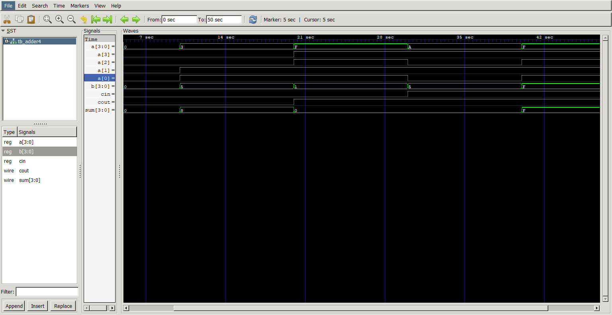

minor Project-1 - 4-bit Adder Using CMOS Logic

## Description
This project implements a 4-bit Ripple Carry Adder using CMOS logic gates.
The adder is built hierarchically from basic gates to full adder to 4-bit adder.

## Modules
- `cmos_inv` - CMOS Inverter (NOT gate)
- `cmos_nand` - CMOS NAND gate
- `cmos_nor` - CMOS NOR gate
- `cmos_xor` - CMOS XOR gate using NAND gates
- `full_adder_cmos` - 1-bit Full Adder
- `adder4_cmos` - 4-bit Adder using 4 Full Adders

## Files
- `adder4_cmos.v` - Design file
- `tb_adder4.v` - Testbench file

## How it Works
A = 4-bit input, B = 4-bit input, Cin = Carry input
Sum = A + B + Cin (4-bit output)
Cout = Final Carry output

Example: A=0011 (3) + B=0101 (5) = Sum=1000 (8)

## Results
Simulation successful ga run ayyindhi.

